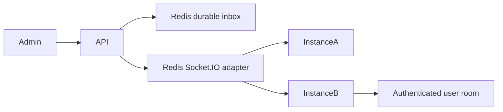

# Realtime Notifications Service

[](https://github.com/yashybm30/realtime-notifications-service/actions/workflows/ci.yml)

An independently runnable portfolio project demonstrating jwt-authenticated socket.io connections, automatic token-expiry disconnect and user-only rooms.

## Implemented behavior

- JWT-authenticated Socket.IO connections, automatic token-expiry disconnect and user-only rooms
- Redis adapter fanout across app instances
- Tenant/user-scoped Redis inboxes with read acknowledgements
- Admin-only publish endpoint and a Redis publish-rate limit

## Architecture



## Requirements and setup

Node.js 24 and npm. Docker Engine with Compose v2 is needed for local databases/queues. Native browser scraping also requires Chromium. Exact dependencies and reproducible versions are in package.json/package-lock.json.

```bash
npm ci
npm run check
```

```bash
cp .env.example .env
# Edit the environment before starting; use random independent signing secrets.
docker compose --env-file .env up --build -d
```

Run one stack at a time because localhost development ports overlap. For native execution, run `npm run build`, start the documented dependencies, apply migrations where applicable, then `npm start`. Node reads `.env` for the start and SQL migration scripts; Vitest requires exported test environment variables. Bash examples use `NAME=value command`; PowerShell uses `$env:NAME='value'` before the command.

## Configuration

- `PORT`: HTTP port (default 3000).
- `JWT_SECRET`: at least 48 random characters; match the trusted issuer when using auth-service tokens.
- `JWT_ISSUER` / `JWT_AUDIENCE`: default `portfolio-auth` / `portfolio-api`.
- `CORS_ORIGIN`: comma-separated browser origins, deny cross-origin by default.
- `REDIS_URL`: local Redis connection where applicable.

## Usage and contracts

Connect with `io(API_URL, {auth:{token:ACCESS_TOKEN}})` and listen for `notification`. Clients cannot choose room names; the server derives a tenant/user room from verified claims. `scripts/client.mjs` is a runnable Node client (`socket.io-client` is a development dependency).

POST `/v1/notifications` accepts `{userId,title,body}` for a recipient in the admin's tenant. GET `/v1/notifications` returns the caller's most recent 100 inbox items. PATCH `/v1/notifications/:id/read` acknowledges only the caller's own item. The publish limit is 60 requests per authenticated subject per minute. Pending notifications can be recovered from the inbox after a disconnect; live delivery does not constitute an exactly-once guarantee.

Run two instances with distinct `PORT` values and the same Redis/JWT settings to exercise cross-instance fanout. Set `CORS_ORIGIN` to the intended browser origins. Never put a bearer token in a URL or logs.

### Authentication and health

Authenticated HTTP examples use `Authorization: Bearer $ACCESS_TOKEN`. Obtain a correctly scoped token from your trusted issuer or the portfolio auth service using the same signing/issuer/audience settings. No production debug token endpoint is exposed. GET `/health/live` verifies the process; GET `/health/ready` checks the project's primary dependencies. `/docs` exposes route documentation; request examples here define the detailed contracts.

## Validation

```bash
npm run check
npm run test:integration  # requires actual local dependencies, where a suite exists
```

Unit tests never imply integration success. Integration suites use disposable namespaces and test signing keys; never point them at production. Tests import compiled application modules to preserve NestJS decorator metadata. See Actions for the current hosted status. External provider calls and cloud deployments are not part of local acceptance.

## Deployment and operations

The Dockerfile uses a separate build stage and a non-root runtime. Start dependencies and migrations before the application. Compose is a local development setup. For GCP/GKE or another cloud, publish a reviewed image, inject secrets using the platform secret manager, configure private dependency connectivity, health probes and resource limits, and verify graceful shutdown. No paid cloud resource is created by this repository.

## Security and trade-offs

Bearer identity is verified with an explicit JWT algorithm, issuer, audience and structured claims. Tenant IDs come from verified tokens, not headers. New services validate access-token expiry but do not introspect the authentication service for immediate token revocation; use short-lived tokens or add an introspection boundary where required. Limits and permission checks are documented per endpoint. Use TLS, workload credentials, restricted networks, backups, request quotas and least-privilege runtime roles before real deployment.

## Known limitations

SMS is not enabled; Twilio is an optional extension. Inbox retention is 30 days after the latest write, with at most 100 records returned per request. High-volume deployments need bounded trimming and Redis persistence/backup policy. Cross-instance adapter behavior has a dedicated integration test when included in the suite.

## Roadmap

Expand failure-mode coverage, validate external integrations in a staging account, add deployment-specific telemetry and retention policy, and review action/dependency updates regularly. Features described above are implemented; this roadmap is not a completion claim.

MIT licensed. See CONTRIBUTING.md and SECURITY.md.

### Standalone development identities

For a disposable local setup without a separate identity server, set the same random `JWT_SECRET` as the API and run `npm run token:dev -- <subject-uuid> <tenant-uuid> <admin-or-member>`. The CLI prints a 15-minute token; it is disabled when `NODE_ENV=production`. Keep it in your shell session, never commit it or paste it into issues. This is a local development utility, not a public login endpoint. Production must use a trusted identity issuer.
